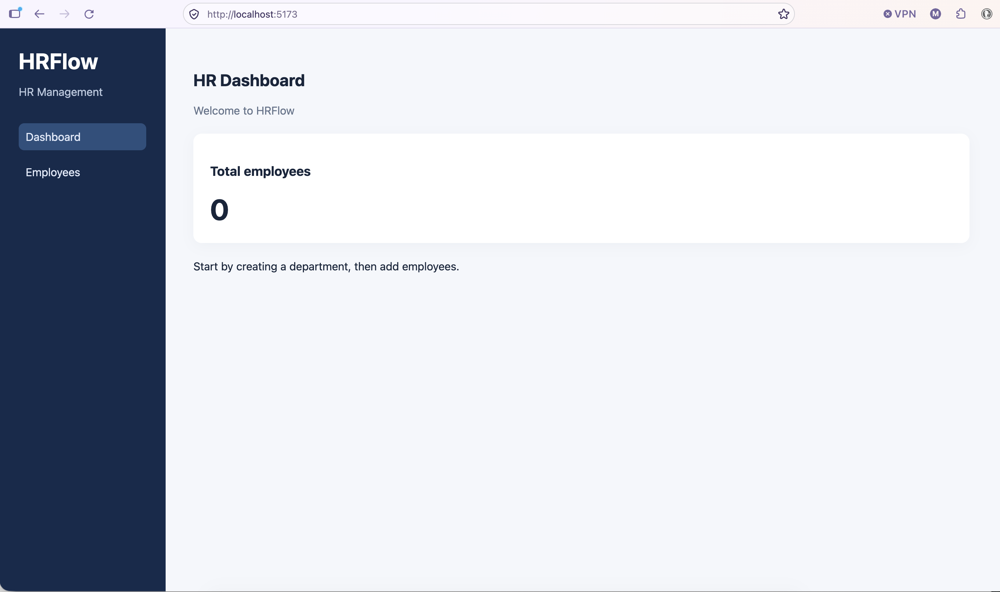
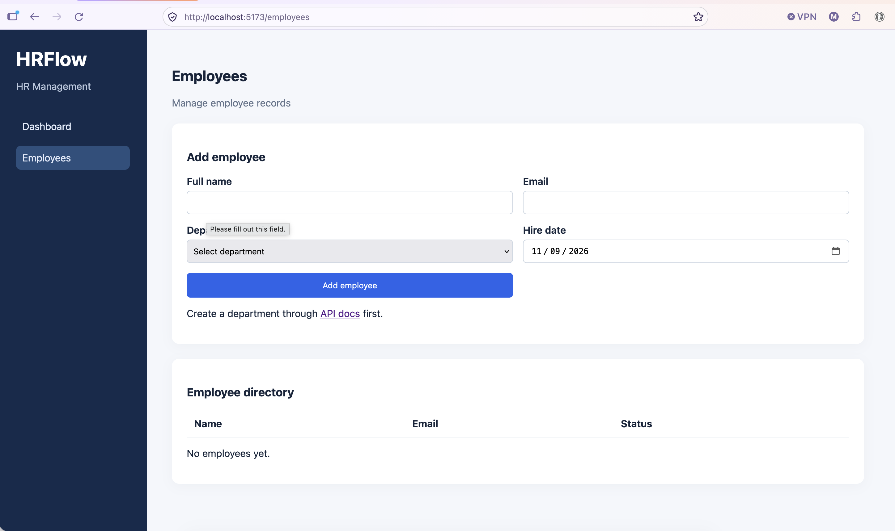
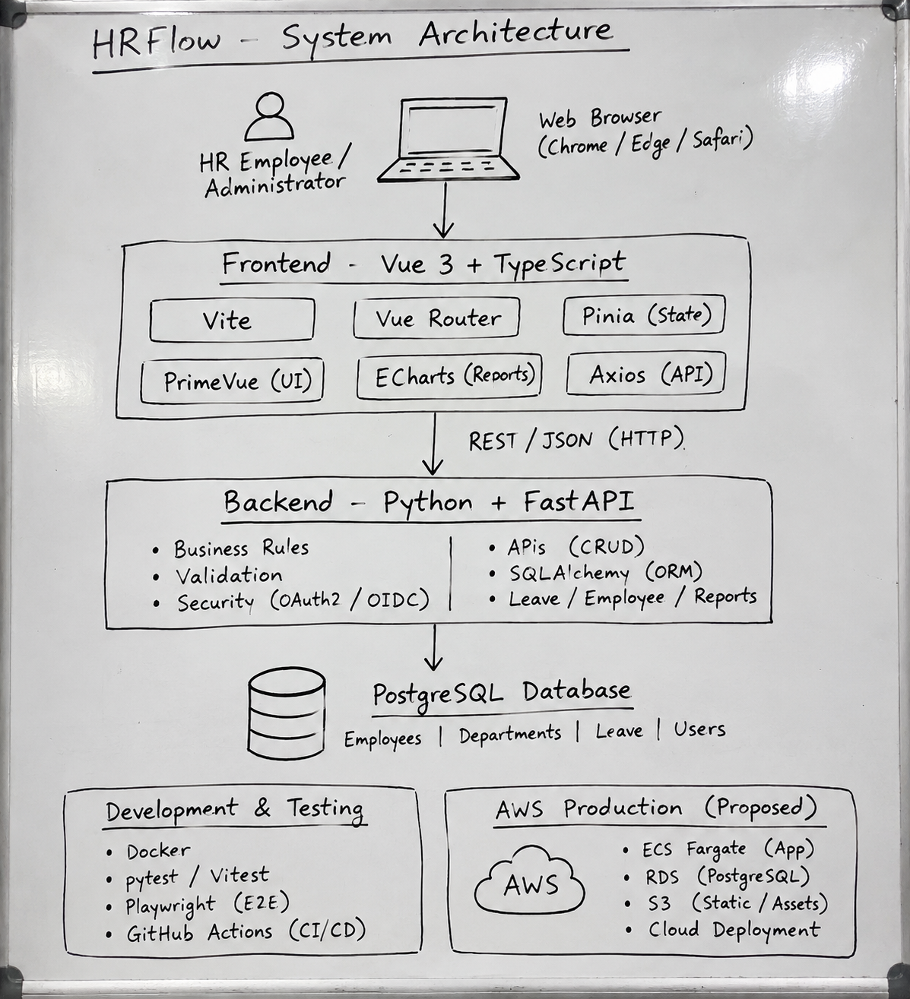
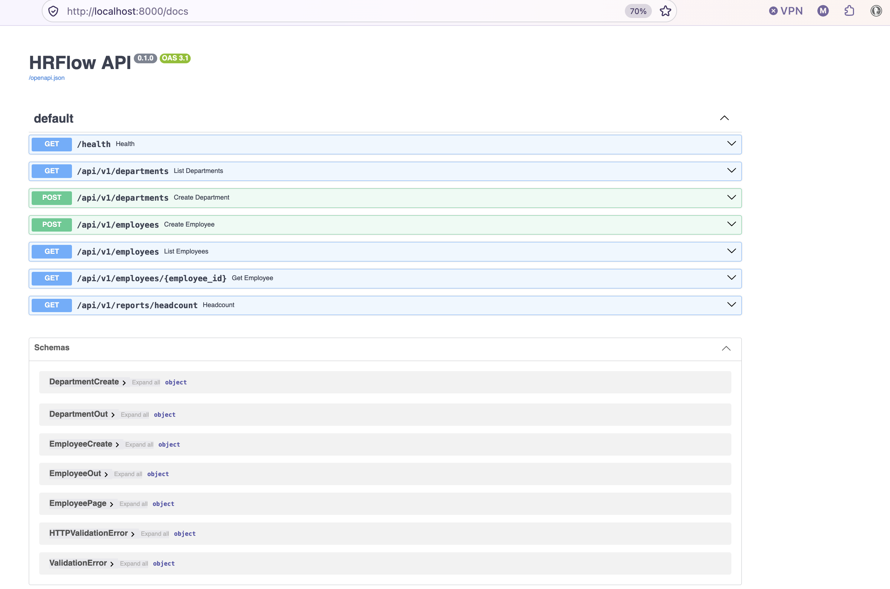

# HRFlow

An HR management app built with **FastAPI**, **PostgreSQL**, and **Vue 3**.









## Features

- Department and employee management via REST API
- Add employees through the Vue 3 UI with form validation
- Employee directory with status tracking
- Headcount report by department
- Paginated employee list endpoint
- Swagger UI for exploring the API
- GitHub Actions CI running pytest on every push

## Stack

| Area     | Tools                                               |
|----------|-----------------------------------------------------|
| Backend  | Python, FastAPI, SQLAlchemy 2, Pydantic v2, pytest  |
| Frontend | Vue 3 (Composition API), TypeScript, Vite, Axios    |
| Database | PostgreSQL 16 (SQLite for local dev without Docker) |
| Infra    | Docker Compose, GitHub Actions CI                   |

## Project structure

```
hrflow-python-vue3/
├── backend/
│   ├── app/
│   │   └── main.py          # FastAPI app, models, schemas, routes
│   ├── tests/
│   │   └── test_api.py
│   ├── Dockerfile
│   ├── requirements.txt
│   └── requirements-dev.txt
├── frontend/
│   ├── src/
│   │   ├── pages/
│   │   │   ├── Dashboard.vue
│   │   │   └── Employees.vue
│   │   ├── services/
│   │   │   └── api.ts
│   │   ├── App.vue
│   │   ├── main.ts
│   │   └── style.css
│   ├── Dockerfile
│   └── index.html
├── docs/
│   ├── images/
│   ├── architecture.md
│   └── deployment.md
├── docker-compose.yml
└── .github/workflows/ci.yml
```

## Getting started

### Prerequisites

- [Docker Desktop](https://www.docker.com/products/docker-desktop/) installed and running
- Git installed

### 1. Clone the repo

```bash
git clone https://github.com/anisur-rahman/hrflow-python-vue3.git
cd hrflow-python-vue3
```

### 2. Set up environment

```bash
cp .env.example .env
```

### 3. Start Docker Desktop

```bash
open -a Docker
```

Wait until Docker Desktop shows the engine is running.

### 4. Build and run

```bash
docker compose up --build
```

This starts three containers: PostgreSQL, the FastAPI backend, and the Vue 3 frontend.

### 5. Open the app

| Service | URL |
|---------|-----|
| Vue 3 frontend | http://localhost:5173 |
| FastAPI Swagger UI | http://localhost:8000/docs |

Create a department in Swagger first, then add employees through the UI.

### Troubleshooting

If the frontend doesn't load, open a second terminal and run:

```bash
docker compose ps
```

All three services (`db`, `api`, `frontend`) should show as `Up`. If one is missing, check the logs:

```bash
docker compose logs --tail=50
```

To stop the app:

```bash
docker compose down
```

## Quick start

```bash
# 1. Start Docker Desktop
open -a Docker

# 2. Start the app
cp .env.example .env
docker compose up --build
```

- Vue 3 dashboard → http://localhost:5173
- FastAPI Swagger UI → http://localhost:8000/docs

Create a department in Swagger before adding employees in the UI.

If the frontend doesn't load, run `docker compose ps` in a second terminal to check all services are up.

## Local dev (no Docker)

```bash
cd backend
python3 -m venv .venv
source .venv/bin/activate
pip install -r requirements-dev.txt
uvicorn app.main:app --reload
```

Runs on SQLite locally so no database setup needed.

## Tests

```bash
cd backend
pytest -q
```

## API examples

```bash
# Create a department
curl -X POST http://localhost:8000/api/v1/departments \
  -H 'Content-Type: application/json' \
  -d '{"name":"Engineering"}'

# Add an employee
curl -X POST http://localhost:8000/api/v1/employees \
  -H 'Content-Type: application/json' \
  -d '{"name":"Jane Doe","email":"jane@example.com","department_id":1,"hire_date":"2024-03-01"}'

# Headcount by department
curl http://localhost:8000/api/v1/reports/headcount
```

## License

MIT
